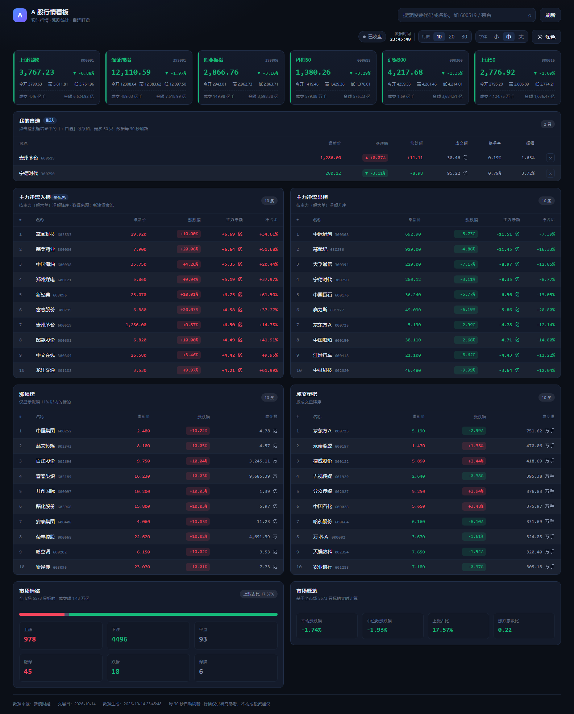
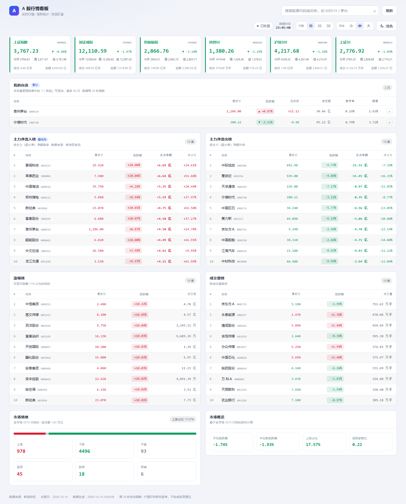

# A 股行情数据项目（ashare-insight）

一个用于获取 A 股股票交易数据的项目，当前已完成**第一个页面：行情总览看板**。

- 后端：Python + FastAPI（行情抓取、缓存、统计聚合）
- 前端：React 19 + Vite + TypeScript（深色行情看板，涨红跌绿）
- 数据源：新浪财经公开行情接口（东财接口在部分网络下会被断连，见文末规划）

## 页面预览

深色（默认）：



浅色：



看板包含（自上而下）：

1. **指数卡片**：上证指数、深证成指、创业板指、科创50、沪深300、上证50 的实时点位、涨跌幅、开高低与成交额
2. **我的自选**：默认包含贵州茅台与宁德时代，展示最新价、涨跌幅、涨跌额、成交额、换手率、振幅；支持删除、搜索添加，记录保存在浏览器本地
3. **主力净流入榜 / 主力净流出榜**（净流入榜最优先展示）：按主力（超大单）净额排序，含最新价、涨跌幅、主力净额、净占比
4. **涨幅榜**：**只显示涨幅 11% 以内的标的**，避开 20cm 涨停把榜单占满
5. **成交量榜**：按成交量（手）降序
6. **市场情绪 / 市场概览**：涨跌平家数、涨停跌停停牌、上涨占比、平均与中位涨跌幅、涨跌家数比
7. **搜索**：支持 6 位代码（`600519`）或中文名称（`茅台`）实时检索，结果可直接「+ 自选」

顶部第一行为品牌与搜索、刷新；第二行为市场状态、数据时间与显示设置（**行数 10/20/30**、**字体 小/中/大**、**主题 浅色/深色**）。页面每 30 秒自动刷新，也可手动刷新。

### 榜单口径说明

| 榜单 | 排序字段 | 过滤规则 |
| --- | --- | --- |
| 主力净流入榜 | 主力（超大单）净额降序 | 仅个股，剔除 ETF / 基金 / 债券 |
| 主力净流出榜 | 主力（超大单）净额升序 | 同上 |
| 涨幅榜 | 涨跌幅降序 | 涨幅 ≤ 11%，剔除停牌 |
| 成交量榜 | 成交量降序 | 剔除停牌 |

- **行数档位**：右上角 10 / 20 / 30 一键切换，作用于资金流榜、涨幅榜、成交量榜；
  前端把它作为 `limit` 传给 `/api/market/overview`，后端按需返回（上限 30）
- 10 条档位下列表完整展示；20/30 条档位下面板内部滚动、表头吸顶，避免把页面撑得过长
- 主力净额单位「元」，接口同时给出净占比（主力净额 / 成交额）；后端按亿元/万元格式化
- 涨幅上限可在 `backend/app/core/config.py` 的 `GAINERS_MAX_PERCENT` 调整（默认 11.0）
- 资金流数据来自新浪资金流接口（`MoneyFlow.ssl_bkzj_ssggzj`），排序由数据源完成；
  注意「净流出榜」不能由净流入榜本地排序得到，必须单独请求升序

### 显示设置（行数、字体与主题）

- **入口**：右上角控制行（`RowCountToggle` + `FontScaleToggle` + `ThemeToggle`），窄屏自动换行，不会挤压搜索框
- **行数**：10 / 20 / 30 一键切换，作用于首页所有榜单；选择存在 `localStorage`（键：`ashare-insight:row-count`）
- **字体**：小 / 中 / 大三档，点一下立即生效；根字号 13 / 14 / 16 px，页面所有字号都用 `rem`，因此整体等比缩放
- **主题**：浅色 / 深色一键切换，两种背景下涨红跌绿都保持辨识度
- 三者都记录在 `localStorage`（键：`ashare-insight:row-count`、`ashare-insight:font`、`ashare-insight:theme`），刷新与重启后保持
- **颜色与字号全部走 CSS 变量**，定义集中在 `web/src/styles/theme.css`，新增页面只引用变量即可自动适配两套主题与三档字号
- 变量约定：`--bg / --panel / --border / --text*` 控制层级，`--up / --down / --flat` 控制涨跌平，`--accent` 为主色，`--font-size-root` 为根字号；另有 `--shadow-panel`、`--skeleton-*`、`--zebra` 等
- 涨跌色按主题分别取值：深色 `#f5455c / #16b979`，浅色 `#d92038 / #0a9d5f`
- 首屏由 `web/public/theme-init.js` 在样式表之前写 `<html data-theme data-font>`，避免主题与字号闪烁
- 已预留「跟随系统」：`useTheme().setPreference('system')` 即跟随系统配色并监听变化，需要时在界面上暴露入口即可

### 自选列表说明

- 默认清单由后端 `DEFAULT_WATCHLIST` 配置（`backend/app/core/config.py`），当前为 `sh600519`、`sz300750`
- 首次访问会带上「默认」徽标；一旦在浏览器里增删过，就以本地记录为准（`localStorage` 键：`ashare-insight:watchlist`）
- 清空浏览器本地记录即可恢复默认清单；上限 60 只
- 换手率、市盈率、市值等字段来自列表接口，首次请求时后台预热全市场清单（约 2 秒），预热完成后自动补齐

## 快速开始

### 一键启动（推荐）

```bash
python dev.py            # 同时启动后端与前端
python dev.py --backend  # 只启动后端
python dev.py --web      # 只启动前端
```

启动后访问：

| 地址 | 说明 |
| --- | --- |
| http://127.0.0.1:5173 | 前端页面（Vite 开发服务器，含热更新） |
| http://127.0.0.1:8000/docs | 后端接口文档（Swagger UI） |
| http://127.0.0.1:8000/api/market/overview | 总览看板聚合接口 |

### 分步启动

```bash
# 1) 安装后端依赖（依赖会装到 backend/.venv 内）
python backend/tools/bootstrap_deps.py

# 2) 启动后端
cd backend && python run.py --port 8000

# 3) 安装并启动前端
cd web && npm install && npm run dev
```

### 单服务模式（只跑后端）

前端构建产物存在时，后端会直接托管页面，此时只需一个服务：

```bash
cd web && npm run build      # 生成 web/dist
cd ../backend && python run.py
# 打开 http://127.0.0.1:8000/ 即为看板页面
```

## 项目结构

```
ashare-insight/
├─ dev.py                       # 一键启动前后端
├─ backend/
│  ├─ run.py                    # 后端启动入口（自动加载 .venv 依赖）
│  ├─ tools/bootstrap_deps.py   # 手动安装依赖（直接解包 wheel，不依赖 pip 临时目录）
│  └─ app/
│     ├─ main.py                # FastAPI 应用、CORS、请求日志、前端静态托管
│     ├─ api/routes_market.py   # 行情路由
│     ├─ models/market.py       # 响应模型（Quote / IndexCard / MarketStats / MarketOverview ...）
│     ├─ core/
│     │  ├─ config.py           # 超时、并发、缓存时长等配置
│     │  ├─ cache.py            # 线程安全的 TTL 缓存
│     │  └─ utils.py            # 数值转换、格式化、板块判定、涨跌停价、交易时段
│     └─ services/
│        ├─ sina_client.py      # 新浪行情接口客户端（重试、分页、并发全市场抓取）
│        └─ market_service.py   # 总览聚合、涨跌统计、榜单、搜索
└─ web/
   ├─ vite.config.ts            # /api 代理到后端
   ├─ public/theme-init.js      # 首屏主题脚本（防闪烁，不参与打包）
   └─ src/
      ├─ App.tsx                # 看板页面组装
      ├─ api/market.ts          # 接口封装
      ├─ hooks/                 # useMarket（总览/搜索）、useWatchlist（自选）
      ├─ theme/                 # ThemeProvider、useTheme、主题与字号档位
      ├─ styles/theme.css       # 全局 CSS 变量（明/暗两套 + 根字号）与基础样式
      ├─ components/            # AppHeader / IndexBoard / WatchList / RankList
      │                         # MarketBreadth / MarketMetrics / ThemeToggle / FontScaleToggle
      ├─ types/market.ts        # 与后端模型对应的类型
      └─ utils/format.ts        # 涨跌配色、时间与代码格式化
```

## 接口一览

| 方法 | 路径 | 说明 |
| --- | --- | --- |
| GET | `/api/health` | 健康检查 |
| GET | `/api/market/overview` | 总览看板聚合数据（指数 + 统计 + 资金流榜 + 涨幅榜 + 成交量榜） |
| GET | `/api/market/indices` | 主要指数行情 |
| GET | `/api/market/fund-flow?order=desc&limit=20` | 主力资金榜（desc 净流入 / asc 净流出） |
| GET | `/api/market/rank?sort_by=volume&order=desc&limit=20` | 排行榜（含 change_percent/amount/volume/main_net_inflow） |
| GET | `/api/market/search?keyword=茅台` | 标的搜索 |
| GET | `/api/market/quotes?codes=sh600519,sz300750` | 批量行情（自选列表用，返回顺序与入参一致） |
| GET | `/api/market/watchlist/default` | 自选股默认清单 |
| GET | `/api/market/quote/{code}` | 单只标的实时行情，如 `sh600519` |
| GET | `/api/market/kline/{code}` | K 线数据（**接口已占位，数据源待接入**） |

### 数据源与字段约定

- 请求地址：`hq.sinajs.cn`（批量行情，单次最多 150 只）与 `vip.stock.finance.sina.com.cn`（列表/榜单，每页 100 条）
- 全市场快照约 5,570 只标的，8 线程并发抓取约 2 秒
- 单位约定：`volume` 为**股**，`amount` 为**元**；新浪列表接口的 `mktcap`/`nmc` 为**万元**，后端已统一换算为元
- 指数成交量数据源以「手」返回，与个股「股」量级等价，已在格式化层区分处理
- 涨跌停按板块判定：主板 10%、创业板/科创板 20%、北交所 30%、ST 股主板 5%
- 缓存策略：指数 5s、榜单 15s、全市场快照 30s、自选行情 5s、标的清单与代码索引 12h（缓存实现在 `core/cache.py`）
- 行情快照接口（`hq.sinajs.cn`）不含换手率与估值，因此自选列表会用列表接口的全市场清单做一次字段补齐

## 后续规划

- [ ] 个股详情页：分时图、五色盘口、日/周/月 K 线
- [ ] K 线数据源接入（腾讯 `web.ifzq.gtimg.cn` 的 fqkline 接口已验证可用）
- [ ] 榜单行点击跳转个股详情，支持板块/市场筛选
- [ ] 资金流榜支持查看 5 日 / 10 日周期（数据源另有对应接口）
- [ ] 自选股分组、拖拽排序与到价提醒
- [ ] 在界面上暴露「跟随系统」主题选项
- [ ] 显示设置改为可折叠面板，支持自定义字号
- [ ] 多数据源自动切换与降级（东方财富为主、新浪/腾讯备用）
- [ ] 数据落盘（SQLite / Parquet）与历史行情批量回补

## 开发环境注意事项

本项目在受限沙箱环境下搭建，有两点与常规流程不同，已做兼容：

1. **依赖安装位置**：`pip` 的临时目录不可写时会安装失败，因此 `backend/tools/bootstrap_deps.py` 直接从镜像下载 wheel 并用 `zipfile` 解包到 `backend/.venv`，`run.py` 启动时自动加载该目录。
2. **Vite 启动**：沙箱禁止为「被捕获输出」的子进程建立管道，而 Vite 启动时会用 `net use` 探测盘符类型。`web/scripts/dev-preload.mjs` 会把这类探测替换为固定结果（仅拦截只读探测命令，其余命令照常执行），`npm run dev:sandbox` 会带上该预加载。

## 免责声明

行情数据来自第三方公开接口，仅供学习与研究使用，可能存在延迟或误差，**不构成任何投资建议**。
